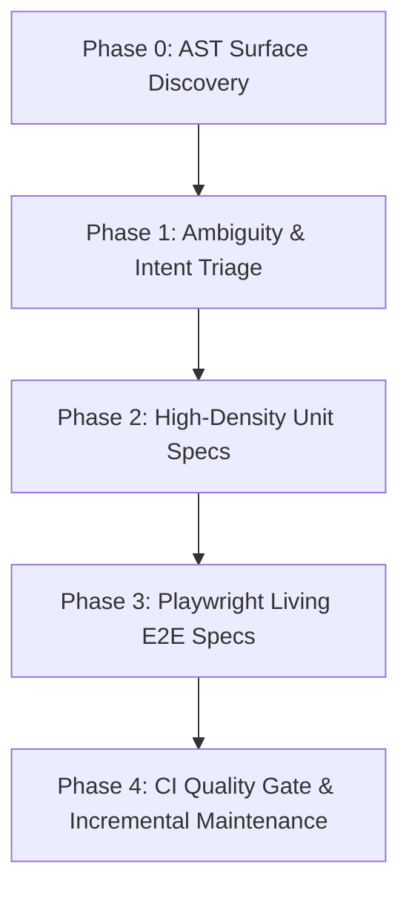

# The Modern Frontend QA & Living Manual Engineering Guide
> **A Comprehensive Framework for Multi-Dimension Frontend Testing, Automated Visual Auditing, and Living User Manual Generation**
> *Based on Production Architecture and Field Lessons from the VeriScribe Paradigm*

---

## Executive Summary

In traditional software development, **testing** and **user documentation** are treated as two disconnected, painful chores:
1. **Test Suites** run silently in CI, generating green checkmarks that executives, product managers, and end-users never see or understand.
2. **User Manuals** are manually written in Word or Confluence, immediately becoming outdated the moment an engineer changes a button label or alters a workflow.

This guide details a unified paradigm: **The Living Specification Spine**. By wiring automated E2E tests directly to visual recorders and markdown/HTML compilers, **your tests become your living user manuals**. When your tests pass, a responsive, screenshot-annotated, multi-role User Manual is generated as an automatic by-product. If the UI changes, the tests break; when the tests are fixed, the manual updates automatically. Documentation drift is eliminated forever.

---

## 1. The 9 Dimensions of Frontend Quality

Most frontend test suites only test Dimension 1 (Happy Path). A robust enterprise application requires verification across **9 distinct dimensions**:

```
                              ┌─────────────────────────────────────┐
                              │    The 9 Quality Dimensions          │
                              └──────────────────┬──────────────────┘
                                                 │
         ┌───────────────────┬───────────────────┼───────────────────┬───────────────────┐
         ▼                   ▼                   ▼                   ▼                   ▼
┌─────────────────┐ ┌─────────────────┐ ┌─────────────────┐ ┌─────────────────┐ ┌─────────────────┐
│ 1. Happy Path   │ │ 2. Resilience   │ │ 3. RBAC & Auth  │ │ 4. Responsive   │ │ 5. Contract     │
│ User Journeys   │ │ Error States    │ │ Shielding & TTL │ │ Desktop/Mobile  │ │ OpenAPI Sync    │
└─────────────────┘ └─────────────────┘ └─────────────────┘ └─────────────────┘ └─────────────────┘
         │                   │                   │                   │
         ▼                   ▼                   ▼                   ▼
┌─────────────────┐ ┌─────────────────┐ ┌─────────────────┐ ┌─────────────────┐
│ 6. WCAG a11y    │ │ 7. i18n         │ │ 8. Performance  │ │ 9. Living Doc   │
│ Accessibility   │ │ Localization    │ │ & WebGL Memory  │ │ Visual Health   │
└─────────────────┘ └─────────────────┘ └─────────────────┘ └─────────────────┘
```

### Dimension 1: Functional Happy Path Journey
- End-to-end user navigation through real business tasks.
- Verifies that inputting valid data produces the expected state change in the UI.

### Dimension 2: Error & Degraded States Resilience
- **HTTP 4xx / 5xx**: What happens when an API fails? (Verify error toasts, snackbars, and friendly user messages).
- **Offline / Network Latency**: What happens on slow 3G or connection drop?
- **Hardware Denials**: What happens when the user clicks "Block Geolocation" or "Deny Camera"?
- **Zero Results**: Verify custom empty-state illustrations, clear explanations, and reset buttons.

### Dimension 3: RBAC & Auth Shielding
- **Gatekeeper Access**: Verify that unauthenticated visitors cannot trigger costly external APIs (e.g., Google Maps Places API quota).
- **Session Lifecycles**: Validate token expiration, automatic redirect to login, and session refresh.
- **Role Permissions**: Ensure `admin`, `user`, and `guest` personas see only their permitted UI controls.

### Dimension 4: Responsive Multi-Viewport Geometry
- Every single feature step must be verified on at least two standard viewports:
  - **Desktop**: 1280×720 or 1440×900
  - **Mobile**: 390×844 (iPhone 14/15/16 baseline)
- Automated assertion against horizontal scrolling (`scrollWidth > clientWidth`) on mobile.

### Dimension 5: Contract & Mock Synchronization
- Component fixtures and E2E mock servers must adhere strictly to the backend `openapi.json` schema.
- Geodesic formulas, date parsers, and data transformers must have isolated deterministic unit tests.

### Dimension 6: Automated Accessibility (WCAG 2.1 AA)
- Integrated `@axe-core/playwright` audits on every rendered page.
- Keyboard navigation: All clickable elements must respond to `Enter` and `Space`.
- Form controls must have associated `<label>` or `aria-label` tags.

### Dimension 7: i18n & Localization
- Automated scanners detect untranslated keys (e.g. `BUTTON_SUBMIT` showing as raw text instead of localized string).
- Living manuals can be compiled into multiple locales (`en-US`, `zh-CN`, `es-ES`) from the same test suite.

### Dimension 8: Performance, WebGL & Memory Leak Cleanups
- **WebGL / Three.js**: Geometries, textures, and renderers must be explicitly disposed in `ngOnDestroy` / `useEffect` cleanup.
- **Animation Loops**: `requestAnimationFrame` must be cancelled on component unmount.
- **RxJS / Event Listeners**: All `.subscribe()` calls must use `takeUntilDestroyed` or unsubscribe patterns to prevent zombie listeners.

### Dimension 9: Living Documentation & Visual Health
- Automated audit for broken image assets (`` returning 404 or `naturalWidth === 0`).
- Automated capture of step-by-step screenshots.
- Compilation into canonical Markdown and interactive responsive HTML manuals.

---

## 2. The 5-Phase Implementation Blueprint



### Phase 0: AST Surface Discovery (The Master Coverage Ledger)
Before writing any tests, scan the codebase using TypeScript Compiler AST (`ts.createSourceFile`) rather than fragile regular expressions:
1. Extract all route trees (including nested `children: [...]` and lazy imports).
2. Extract all component selectors, templates (both external and inline backtick templates), inputs, outputs, and model signals.
3. Map component dependencies (e.g. what child components are rendered by what page).
4. Output a **Master Coverage Ledger** (`qa-system/qa-manifest.json`) that tracks every file and its 9-dimension verification status.

### Phase 1: Ambiguity & Intent Triage
> [!CRITICAL]
> **The Golden Rule**: *Never cement an existing bug into a test assertion.*

When scanning legacy or WIP codebases, you will encounter ambiguities:
- A button with no click handler.
- A form validator that allows invalid emails.
- A component with an RxJS subscription that is never cleaned up.

**Do not write a test asserting the broken behavior.** Record it in `qa-manifest.json` under `ambiguitiesOrSuspectedBugs` with `"resolution": "OPEN"` and resolve it with product stakeholders before locking behavior into tests.

### Phase 2: Component & Service Unit Testing Standards
Ban shallow stubs. A test like this is useless:
```typescript
// ❌ ANTI-PATTERN: Shallow stub testing nothing
it('should create', () => {
  expect(component).toBeTruthy();
});
```

Enforce behavioral testing:
```typescript
// ✅ BEST PRACTICE: Behavior-driven unit testing
it('should display empty state when filter matches zero places', () => {
  component.places.set([]);
  fixture.detectChanges();
  const emptyBanner = fixture.nativeElement.querySelector('.empty-state-banner');
  expect(emptyBanner).not.toBeNull();
  expect(emptyBanner.textContent).toContain('No Pandan spots found');
});
```

### Phase 3: Playwright Living E2E Specs & Manual Recording
Create a dedicated living spec runner (like `ManualJourneyRecorder`) that hooks into Playwright:
1. **Declare Chapter Metadata**: Title, user persona, preconditions, and responsive viewport configuration.
2. **Execute Actions**: Perform real browser clicks and form inputs.
3. **Capture Dual Viewports**: Take full-resolution Desktop and Mobile screenshots.
4. **Assert Visual Health**: Ensure no broken images, container overflows, or Axe accessibility violations exist on the page.

### Phase 4: CI/CD Quality Gate & Incremental Maintenance
1. On every Git commit, run an **Incremental Impact Analyzer** that checks `git diff` against the last verified commit.
2. Re-run only the unit specs and Playwright journeys impacted by modified files.
3. Re-compile the Living User Manuals automatically.
4. If any unverified components or broken E2E steps exist, fail the CI gate (`exit 1`) to block deployment.

---

## 3. Real-World Field Lessons & Gotchas

During the implementation of this system in production, we solved 5 major cross-platform challenges:

### Lesson 1: Headless Geolocation Mocking
- **The Problem**: In headless CI environments (Linux Docker, GitHub Actions, headless Chrome), `navigator.geolocation.getCurrentPosition` either times out or gets denied by default security policies.
- **The Solution**: Inject deterministic GPS coordinates via `page.addInitScript` before page load:
```typescript
await page.addInitScript(() => {
  navigator.geolocation.getCurrentPosition = (success) => {
    success({
      coords: {
        latitude: 3.140853,
        longitude: 101.693207,
        accuracy: 10,
        altitude: null,
        altitudeAccuracy: null,
        heading: null,
        speed: null,
      },
      timestamp: Date.now(),
    });
  };
});
```

### Lesson 2: Third-Party SDK Shielding (e.g. Google Maps)
- **The Problem**: Running E2E tests against live Google Maps or payment APIs burns expensive API quotas and causes flaky test runs when network latencies spike.
- **The Solution**: Intercept external script tags (`maps.googleapis.com`) using `page.route()` and supply a deterministic mock SDK that renders real HTML marker badges into the DOM. This allows Playwright to interact with pins without hitting Google's servers.

### Lesson 3: WebGL / 3D Canvas Memory Leaks in CI
- **The Problem**: Rendering Three.js 3D animations in headless Chrome triggers GPU driver warnings (`GPU stall due to ReadPixels`) and memory leaks if multiple tests create WebGL contexts.
- **The Solution**: 
  1. Wrap animation loops in `ngZone.runOutsideAngular` to avoid thrashing change detection.
  2. Implement strict context destruction in `ngOnDestroy`: call `renderer.dispose()`, remove event listeners, and cancel `requestAnimationFrame`.

### Lesson 4: Dual-Viewport Flipping Without Corrupting State
- **The Problem**: Resizing `page.setViewportSize()` to capture a mobile screenshot can trigger media query re-renders that reset scroll positions or break subsequent desktop assertions.
- **The Solution**: Always snapshot the current viewport before capturing, resize temporarily, take the mobile snapshot, and restore the original viewport immediately:
```typescript
const originalViewport = page.viewportSize();
await page.setViewportSize({ width: 390, height: 844 });
await page.screenshot({ path: mobilePath });
if (originalViewport) {
  await page.setViewportSize(originalViewport);
}
```

### Lesson 5: Automated Broken Image Detection
- **The Problem**: Pages load with HTTP 200, but placeholder images or external CDN avatars fail to render, resulting in broken image icons in production.
- **The Solution**: Audit the live DOM geometry in Playwright:
```typescript
const brokenImages = await page.evaluate(() => {
  return Array.from(document.querySelectorAll('img'))
    .filter(img => !img.complete || img.naturalWidth === 0)
    .map(img => img.src);
});
if (brokenImages.length > 0) {
  throw new Error(`Broken images detected: ${brokenImages.join(', ')}`);
}
```

---

## 4. Copy-Pasteable Living E2E Spec Template

Use this starter template in any Playwright project:

```typescript
import { test, expect } from '@playwright/test';
import { ManualJourneyRecorder } from 'veriscribe/playwright';

test.describe('Feature Slice: User Checkout Journey', () => {
  test('Complete Order Checkout & Record Living Manual', async ({ page }) => {
    const manual = new ManualJourneyRecorder(page, {
      chapterId: 'order-checkout',
      featureTitle: 'Placing an Online Order',
      summary: 'Step-by-step guide on selecting products, adding to cart, and completing checkout.',
      role: 'user',
      locale: 'en-US',
      routePath: '/checkout',
      preconditions: [
        'User is logged into their account.',
        'At least one item is present in the cart.'
      ],
      captureResponsiveViewports: true // Emits Desktop & Mobile snapshots!
    });

    await page.goto('/checkout');

    // Step 1: Review Cart
    const cartSummary = page.locator('#cart-summary');
    await expect(cartSummary).toBeVisible();
    await manual.recordStep({
      title: 'Review Cart Items',
      userInstruction: 'Inspect your selected items, quantities, and delivery address.',
      expectedOutcome: 'Itemized totals and shipping costs are displayed clearly.',
      target: cartSummary,
      notes: 'Discounts and promotional codes are applied automatically.',
      action: async () => {
        await expect(cartSummary).toContainText('Subtotal');
      }
    });

    // Step 2: Submit Payment
    const submitBtn = page.locator('button#submit-order');
    await manual.recordStep({
      title: 'Confirm and Pay',
      userInstruction: 'Click the Confirm Order button to finalize payment.',
      expectedOutcome: 'Order confirmation modal appears with your tracking number.',
      target: submitBtn,
      action: async () => {
        await submitBtn.click();
        await expect(page.locator('#order-confirmed')).toBeVisible();
      }
    });

    // Verify WCAG accessibility and multi-viewport layout health
    await manual.assertNoAxeViolations();
    await manual.verifyVisualHealth();
  });
});
```

---

## 5. Checklist for Bringing This to Other Projects

When rolling this out to a new team or repository, execute these steps in order:

- [ ] **1. Install Core Dependencies**:
  ```bash
  npm install -D veriscribe @playwright/test @axe-core/playwright
  ```
- [ ] **2. Initialize the QA Engine**:
  ```bash
  npx veriscribe init
  ```
- [ ] **3. Scan the Surface**:
  Run `npm run qa:scan` to generate the initial `qa-manifest.json` and `coverage-audit.md`.
- [ ] **4. Triage Ambiguities**:
  Review any uncovered components or dead template branches before writing tests.
- [ ] **5. Author Living Specs**:
  For each primary route, write a Playwright living spec using `ManualJourneyRecorder`.
- [ ] **6. Compile Living Manuals**:
  Run `npm run qa:manual` to generate `USER_MANUAL.md` and `USER_MANUAL.html`.
- [ ] **7. Connect CI Gate**:
  Add `npm run qa:gate` to your GitHub Actions / GitLab CI pipeline to enforce 0 regressions on every pull request.
