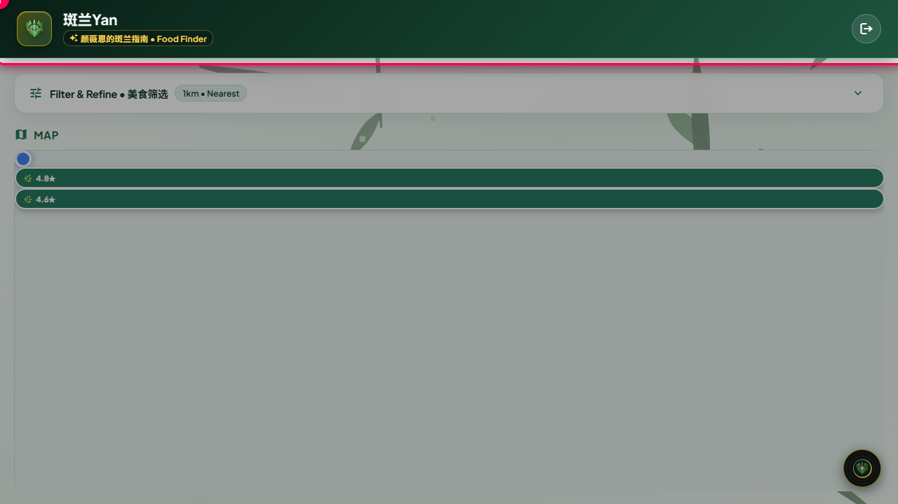
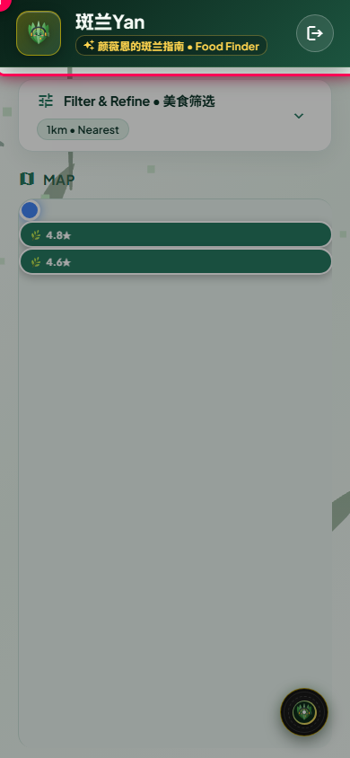
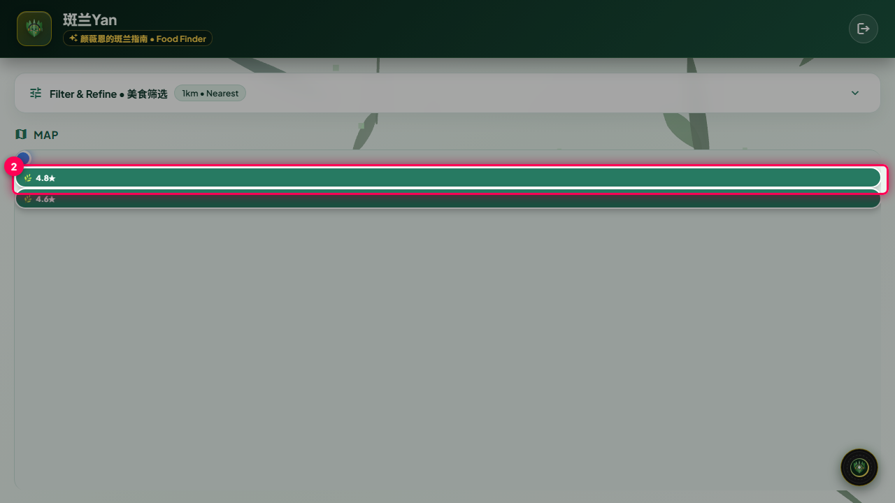
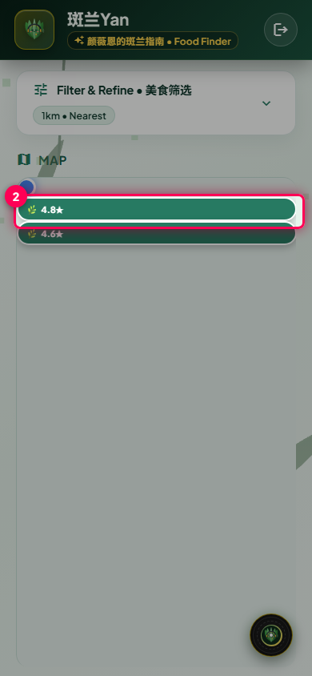
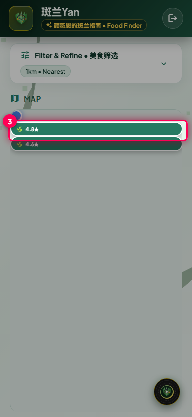
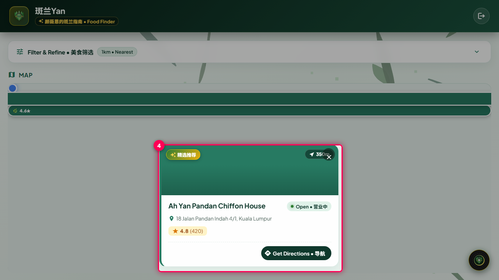
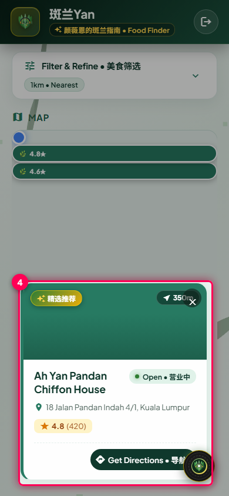
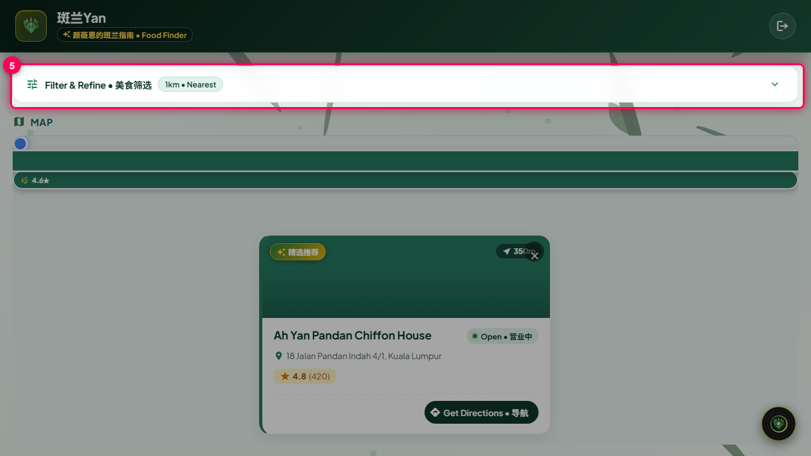
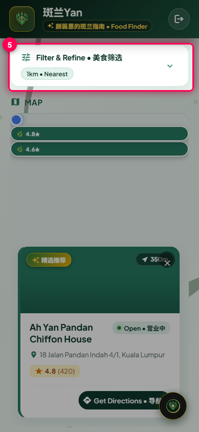

# Product User Manual (USER — en-US)

_Automatically verified and generated from Playwright E2E Living Specifications._

### Table of Contents
- [Discovering Nearby Pandan Food & Bakeries](#nearby-food)

---
## Discovering Nearby Pandan Food & Bakeries

> **Role**: `user` | **Language**: `en-US` | **Route**: `/`

Learn how to explore nearby Pandan chiffon cakes, kuih, and local bakeries with real-time distance and interactive map.

### Prerequisites
- Browser location permission is granted.
- Authenticated using preset access credentials.

### Step-by-Step Guide

#### Step 1: Open Pandan Discovery Dashboard
- **Action**: Launch the application in your browser. The system will detect your location and initialize the interactive food map.
- **Expected Result**: The hero header, 3D leaf backdrop, and interactive map container are displayed.
- **Tip**: Ensure your device location services are turned on for accurate geodesic distance calculations.

📱 <strong>Mobile View (390×844)</strong>

#### Step 2: Explore Nearby Pandan Pins on Map
- **Action**: Scan the interactive Google Map to view pins indicating verified Pandan culinary locations within walking distance.
- **Expected Result**: Map markers display rating badges (e.g. 4.8★) positioned at exact geodesic coordinates.
- **Tip**: Each marker is filtered to exclude non-food businesses in townships named Pandan.

📱 <strong>Mobile View (390×844)</strong>

#### Step 3: Select a Spot for Detailed Information
- **Action**: Click any green Pandan pin on the map to bring up the establishment card overlay.
- **Expected Result**: A floating card displays the food spot name, star rating, address, opening hours, and distance.

📱 <strong>Mobile View (390×844)</strong>

#### Step 4: Review Spot Details & Opening Hours
- **Action**: Inspect the specialty highlights, rating badge, address, and live open status.
- **Expected Result**: Detailed info confirms business name, photo preview, and open status.
- **Tip**: The badge tags top-tier chiffon cakes, authentic kuih, and waffles.

📱 <strong>Mobile View (390×844)</strong>

#### Step 5: Filter by Distance Radius and Rating
- **Action**: Use the filter panel to select maximum walking distance (e.g., 1km, 3km, 5km) or filter by minimum rating.
- **Expected Result**: The map dynamically adjusts pins matching the updated filter preferences.

📱 <strong>Mobile View (390×844)</strong>

### Troubleshooting & Common Messages

| Scenario | Message Displayed | How to Resolve |
| :--- | :--- | :--- |
| No Pandan Spots Visible within 1km | `No authentic Pandan spots found nearby` | Expand search radius to 3km or 5km using the filter panel, or click "Try Again" after granting location permission. |
